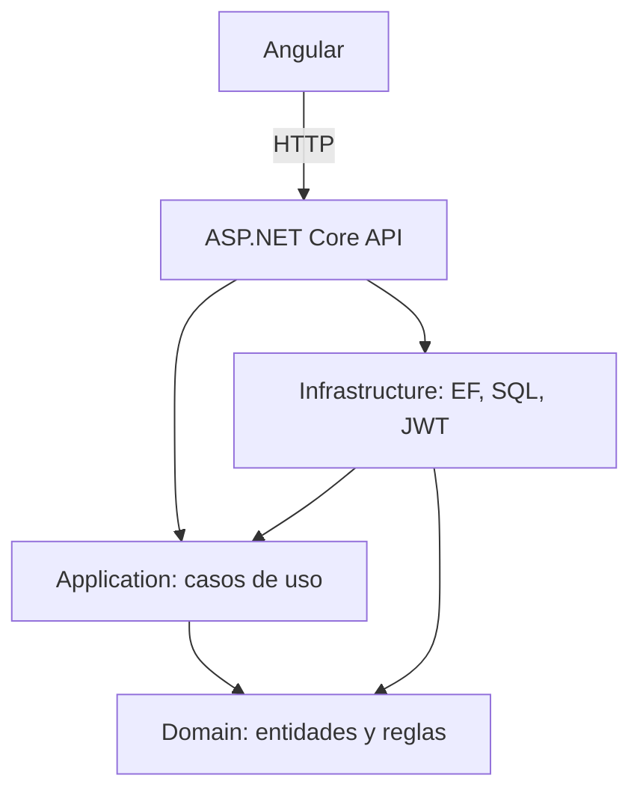

# Arquitectura actual y evaluación de SOLID

Base observada: `aa802e210d15c70784f79dea2580709166b843c7`. Este documento describe código existente. [La propuesta inicial](../05-arquitectura-propuesta.md) es un antecedente.

## Dependencias verificadas

Las flechas de backend representan referencias de proyecto verificadas en `.csproj`. Domain no depende de EF, HTTP o Infrastructure; Application depende de Domain y de contratos propios. Infrastructure implementa repositorios/seguridad y la API compone dependencias. Angular usa DTOs y servicios HTTP por área, componentes standalone y CSS estándar.

No se encontró MediatR ni NgRx como parte del diseño actual. Los casos de uso separan responsabilidades de lectura/mutación de forma parcial; no conviene convertir el proyecto a un framework CQRS para corregir defectos localizados.

## Evaluación por principio

| Principio | Evaluación fundamentada | Acción |
|---|---|---|
| S: responsabilidad única | Buena separación de capas; importaciones, Program y catálogo combinan razones de cambio distintas | Extraer por módulo/caso de uso con pruebas; el tamaño sólo es una señal |
| O: abierto/cerrado | Interfaces y módulos permiten extensión, pero switches/strings y wiring central obligan a tocar varios lugares | Centralizar políticas internas puntuales y modularizar endpoints sin un sistema genérico innecesario |
| L: sustitución | No se identificó una violación concreta que justifique refactor; no es una certificación general | Mantener contratos de repositorios y probar comportamiento equivalente; no equiparar SQLite/InMemory con SQL Server |
| I: segregación | Hay abstracciones por dominio; algunos consumidores reciben superficies amplias | Introducir lecturas específicas donde el N+1 y la cohesión lo justifiquen, no una interfaz por cada clase |
| D: inversión | Verificada en referencias y DI; persistencia queda fuera del núcleo | Conservar dirección de dependencias y probar límites automáticamente |

**Dictamen:** principios aplicados parcialmente con fundamentos sólidos. La deuda principal es cohesión/SRP y disciplina de contratos/estado, no ausencia de capas. No corresponde afirmar cumplimiento total de SOLID ni reemplazar evidencia por una puntuación arbitraria.

## Reglas de negocio y consistencia

- Pedido comercial: líneas con identidad, unidad y precio snapshot; adicional y corrección son diferentes.
- Producción: lotes físicos y asignación diaria a líneas, con saldo y reversión explícita.
- Reparto: ruta/vuelta, reserva por línea y eventos de conteo/carga/entrega. Custodia conserva cantidades que no se entregaron; no libera carga silenciosamente.
- Lecturas no crean estados. Commands críticos usan transacciones, versión y recibos de operación durables; C1 añade recuperación de esa identidad tras navegar; su despliegue está pendiente.
- Autorización: permisos efectivos por petición y alcance propio del chofer; menú/guardas no sustituyen el servidor. Tokens recuperables con AES-GCM y clave externa.
- Historial de cantidades/ubicación/instrucciones se conserva por snapshot. Resolver una divergencia exige alcance explícito, no leer silenciosamente el valor actual del cliente.

## Refactor seguro

Empezar por una extracción con razón de cambio clara y aceptación observable. Conservar DTOs/URLs/strings públicos, transacciones y semántica. Añadir pruebas de arquitectura para las referencias y regresiones del caso de uso. Optimizar lecturas mediante lotes/proyecciones; no paralelizar un mismo DbContext ni reducir aislamiento del ledger como atajo.

Medidas observadas: `AdminImportService` 2265 líneas, `Program` 1164 y `AdminCatalogsComponent` 953 (sin contar migraciones generadas). No se impone un máximo de líneas: la aceptación es independencia de responsabilidades y pruebas claras.

## Correcciones C1 sobre esta arquitectura

Se conserva la dirección de dependencias. `ProductionCommandStore` separa la
persistencia/validación del reintento de su presentación Angular; la vista usa
comandos tipados y el servidor conserva los recibos transaccionales.
`AdminLoginRateLimiting` agrupa política/opciones del acceso administrativo en
el borde API, con cambios mínimos de composición. `OrderNoteLimits` centraliza
límites del dominio compartidos por validación y mapping EF. La disposición de
reintento en conflictos es un campo aditivo; no se interpretan textos de error.

Estas extracciones acotadas mejoran cohesión sin introducir nuevos frameworks.
No sustituyen los refactors F21/F22 pendientes. [Correcciones y pruebas](../corrections/C1.md).
